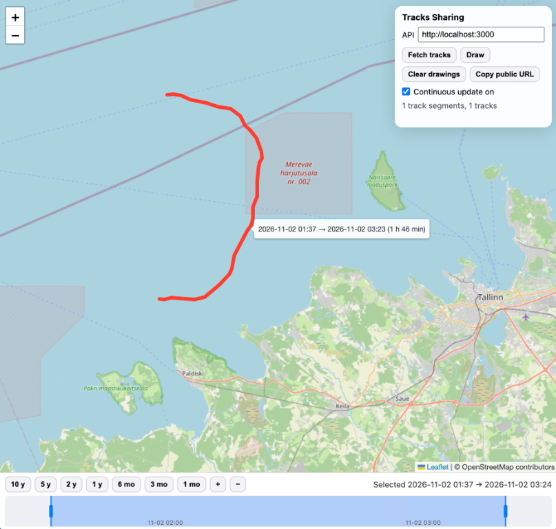

# trackdraw

Two things live in this repository.

## 1. GitHub Pages application (`index.html`)

Simple static html page showing a map that you can draw on, and then share the drawing, all client side. Suitable for example for displaying vessel GPS/GNSS tracks, just import your track as GeoJSON MultiLineString or LineString.

Demo: https://tkurki.github.io/trackdraw/#l=59.885462%2C23.311007&z=12&d=AWQAm_8CA1AM-NKTOdivohaJigLOCtG_AYeoBPY3y4MDu4oB-VS9ogGB3wGdRbCzA6c17cMCm4UByl_TeqyPAf9Hj9kCgegB3D_WAozijjmSvKEWq5EBl5kFnwKgm5I5zNugFvdwnIwC

## 2. Signal K webapp (`public/`)



Installable as a Signal K server webapp (`signalk-webapp` keyword, served at `/signalk-tracks-sharing/`). It shows a map and fetches tracks from the Signal K Tracks API (`/signalk/v2/api/tracks`, provided for example by `@signalk/tracks-plugin`) for the current map bbox and the selected time range. When not served by a Signal K server the API defaults to `https://demo.signalk.io`; the API base can be changed in the panel.

- Tracks are simplified on the server (`simplify`/`epsilon`/`maxPoints`) with a tolerance of half a screen pixel for the current view.
- The URL (`#l=lat,lng&z=zoom&d=...`, same format as the GitHub Pages app) is the source of truth: fetched tracks are written to the URL and the map is rendered from it. Editing the URL updates the map.
- The timeline at the bottom has presets (10, 5, 2, 1 years; 6, 3, 1 months) and +/- zoom. Drag on it to select a sub range, and drag the handles at the ends of the selection to adjust it. Every change of bbox or time range refetches tracks.
- *Copy public URL* copies a link to the current view and drawings on the GitHub Pages app (https://tkurki.github.io/trackdraw/), so it can be shared with people who have no access to the Signal K server.
- Continuous update is disabled when you draw on the map, edit the URL manually, or open a URL that already contains drawings. It can be re-enabled from the panel, which removes the drawings.

### Test environment

```
docker compose -f dev/docker-compose.yml up -d        # signalk-server + tracks plugin + this webapp
node dev/generate-tracks.js http://localhost:3000      # import generated passages
```

Open http://localhost:3000/signalk-tracks-sharing/ (and pan to the Gulf of Finland). `npm test` runs the codec unit tests.
